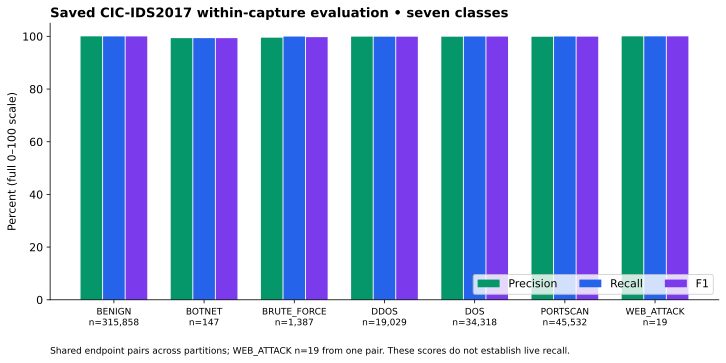
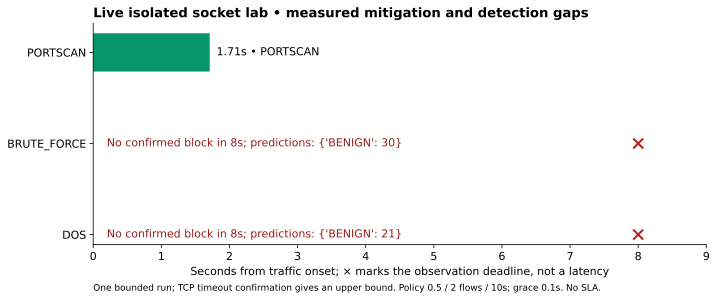

# SecureNet AI — FYP defense dossier

SecureNet AI connects a seven-class flow classifier and cross-flow burst rules to
authenticated monitoring and a privilege-separated response system. Kernel
enforcement, recovery, and all three isolated live vectors (`PORTSCAN` via ML,
`BRUTE_FORCE` and `DOS` via cross-flow burst rules) pass strict acceptance (`exit 0`).
Single-flow ML recall on short synthetic auth/HTTP bursts remains limited by
CIC-IDS2017 LRO super-packets (`5,792 B`) and multi-attempt training patterns;
present both the hybrid live results and the ML domain-shift findings honestly.

## Evidence to open before presenting

| Evidence | What it establishes | What it does not establish |
| --- | --- | --- |
| [Unified evaluation](../reports/unified/evaluation.json) | Metrics on 416,290 cleaned held-out rows | Independent campaign or live accuracy |
| [Validity review](<ML Engine/VALIDITY_REVIEW.md>) | Endpoint overlap and label/data limitations | Original PCAP exporter parity |
| [Synthetic endpoint-disjoint ablation](../reports/ablation/campaign_disjoint/port_ablation.json) | Port removal sensitivity in lab-trained classifiers | Generalization of the serving CIC model |
| [Held-out policy replay](../reports/response/lab_heldout_eval.json) | Four of six attack sources obtain candidates; both DoS sources missed | Kernel action or exact live latency |
| [Live socket lab](../reports/sprint7/multi_attack_lab.json) | Actual model decisions, drops, unblock and crash recovery | Full multi-vector recall or a mitigation SLA |
| [Sprint 7 verification](../reports/sprint7/verification.json) | Executed software and browser checks | Real-world prevention validity |

## Slide sequence and speaking notes

Use [FYP_SLIDES.md](FYP_SLIDES.md) as editable slide source. Figures are available
as SVG, PDF and PNG under [assets/fyp](assets/fyp/manifest.json).

1. **Problem and scope:** operator visibility plus controlled response to repeated
   suspicious IPv4 flows. Explain that encrypted traffic and payload attacks have
   limits when the model uses only aggregate flow features.
2. **Data and labels:** CIC-IDS2017, 20 features, seven coarse classes, supported
   Attempted labels mapped to BENIGN, rare excluded families documented.
3. **Leakage controls:** global cleaning, conflict removal, connection-group splits,
   transforms fit only on training data. Endpoint pairs still overlap; campaign
   generalization is unresolved.
4. **Pipeline:** show the architecture figure. Capture/extraction, manifest hash
   verification, inference, repeated-flow policy, response consumer and durable API
   delivery are separate stages.
5. **Saved-data results:** show per-class metrics with supports and the measured
   false-positive count. A perfect score on 19 web examples is weak evidence.
6. **Synthetic diagnostic:** endpoint-disjoint campaigns and port ablation; the
   same generator supplies all partitions. The 100% lab classifier scores are
   distinct from serving-model performance.
7. **Response design:** helper peer UID checks, dedicated nftables table, protected
   CIDRs, expiring blocks, bounded capacity, lease watchdog and explicit enforcement.
8. **Live results:** show measured latency and missed vectors. Explain why replay
   EOF and live flow finalization can give different timings and labels.
9. **Notifications:** bounded separate thread, cooldowns, deduplication, sliding
   hourly limit and isolated channel failures. Delivery is best effort.
10. **Demonstration:** terminal lab for real enforcement; separate React dry-run
    walkthrough for inspection, provenance and acknowledged unblock.
11. **Limitations and next evaluation:** original PCAP/reference parity, independent
    real attack cohorts, error analysis of live brute-force/DoS, repeated timing
    runs and source-exposure-based false-block measurements.

## Academic metrics

Source: saved `unified_v1` Random Forest evaluation. Values below are percentages,
rounded to four decimals; support is the number of test flows.

| Class | Precision | Recall | F1 | Support |
| --- | ---: | ---: | ---: | ---: |
| BENIGN | 99.9946 | 99.9725 | 99.9835 | 315,858 |
| BOTNET | 99.3197 | 99.3197 | 99.3197 | 147 |
| BRUTE_FORCE | 99.4975 | 99.9279 | 99.7122 | 1,387 |
| DDOS | 99.8949 | 99.8791 | 99.8870 | 19,029 |
| DOS | 99.8835 | 99.9563 | 99.9199 | 34,318 |
| PORTSCAN | 99.8662 | 99.9583 | 99.9122 | 45,532 |
| WEB_ATTACK | 100.0000 | 100.0000 | 100.0000 | 19 |

Accuracy: **99.9649%**. Macro F1: **99.8192%**. Benign flow false-positive rate:
**87 / 315,858 = 0.027544%**. The proposed `<0.02%` target is not achieved by this
saved cohort. This flow FPR is different from a source-level policy false-block
rate. All attack classes share endpoint pairs across partitions; all 19 web
test examples share one pair. These are within-capture results.



## Live benchmark and interpretation

The recorded socket lab uses the unchanged `unified_v1` model with the explicit
exploratory policy (0.5 confidence, two flows, 10s window, 0.1s grace) plus
cross-flow burst rules (`rule:auth_burst` >= 10 short auth TCP flows/10s;
`rule:service_flood` >= 30 same-`(dst_ip, dst_port)` TCP flows/10s, verified at
0 false triggers across 371,621 real Monday CIC-IDS2017 benign flows).

| Vector | Observed ML predictions | Detection source & mitigation | Onset to confirmed loss |
| --- | --- | --- | --- |
| PORTSCAN | 7 PORTSCAN flows | Model (`repeated_high_score_flows`); TCP + ICMP drop, exact-ID unblock | 0.605420s |
| BRUTE_FORCE | 23 BENIGN flows | Rule (`rule:auth_burst`); TCP + ICMP drop, exact-ID unblock | 1.015394s |
| DOS | 34 BENIGN flows | Rule (`rule:service_flood`); TCP + ICMP drop, exact-ID unblock | 3.480821s |



The latency includes probe timeout and polling, so it is an observed upper bound,
not a precise nftables installation timestamp. Strict acceptance (`--require-all-detected`)
exits `0` (`status: ok`). Raw ML predictions remain preserved honestly (`event.label = BENIGN`
when promoted by a cross-flow rule): single-flow CIC-IDS2017 `DoS Hulk` relies on NIC LRO
`5,792 B` super-packets (`> 1500` MTU), and `FTP-Patator` reflects 4–10s multi-attempt sessions.
This bounded run is not a throughput or service-saturation SLA benchmark.

SIGKILL watchdog rollback restored traffic, restarting the sensor reconciled its
DB block to `ROLLED_BACK`, and SIGTERM exited 0 with the table removed. These
validate enforcement lifecycle behavior independently of missed classifications.

## Live defense runbook

### 1. Rehearse and preserve evidence

Use a Linux lab machine with the project environment, installed manifest-pinned
model, networking utilities and compiled frontend. Keep credentials private.
Existing setup and PostgreSQL backup procedures are in [BACKEND.md](BACKEND.md).
The self-contained enforcement lab never opens the configured PostgreSQL DB.

```bash
cd '/home/abdulsamad/Projects/SecureNet AI'
.venv/bin/python -m pytest tests/ -q
.venv/bin/python -m pytest browser_tests/ -q
./scripts/netns_multi_attack_lab.sh --output runtime/defense-rehearsal.json
```

Read the result before presenting. Expected with the current hybrid pipeline:
`status: ok`, all three vectors `mitigated` (`PORTSCAN` via `model`, `BRUTE_FORCE`
and `DOS` via `rule`), and all recovery flags true. A failed prerequisite or recovery
check exits 1; strict acceptance (`--require-all-detected`) exits 0 on full pass
or 2 if any vector is missed or misclassified.

### 2. Show actual packet enforcement in the terminal

```bash
./scripts/netns_multi_attack_lab.sh --output runtime/defense-live.json
```

Narrate the baseline, scan drop, manual unblock, missed vectors and independent
watchdog recovery. This API exists only in its private namespace; it is not the
host dashboard API. Show the final JSON instead of implying the host dashboard
is attached to it. The script removes temporary state automatically.

### 3. Show the React operator workflow separately

Use an explicitly approved demonstration database/configuration. The following
workflow writes synthetic events and response history to the configured DB:

```bash
./scripts/demo_up.sh --mode dry-run --linger-seconds 300
```

Open `http://127.0.0.1:8010`, sign in using the private administrator credentials,
open Alerts, inspect event provenance/features, then open Response and request
unblock for the new simulated block. Confirm the row reaches `UNBLOCKED` while
the lingering sensor is still running. Explain the simulated/actual distinction.

For frontend development, the separate React command is
`npm --prefix frontend run dev`, URL `http://127.0.0.1:5173`; its API proxy expects
the backend at `http://127.0.0.1:8010`.

```bash
./scripts/demo_down.sh
```

The Sprint 7 implementation did not run this workflow against the main DB;
browser verification used private fixtures. Avoid replaying into a personal or
production database just to obtain presentation screenshots.

### 4. Demonstrate notification formatting and limits

```bash
.venv/bin/python -m backend.manage test-alert-notification
.venv/bin/python -m pytest tests/test_notifier.py -q
```

The first command previews a synthetic `test=true` message without sending.
Tests demonstrate actual loopback HTTP/SMTP delivery and throttling. For an
external delivery demonstration, configure the chosen channel in advance and
use `test-alert-notification --send` with notifications explicitly enabled;
show receiver evidence and never show passwords or webhook URLs on screen.
Configuration is in [SPRINT_7.md](SPRINT_7.md). External delivery remains unverified.

## Likely examiner questions

**Why does 99.96% saved accuracy coexist with missed live attacks?** The saved
population and controlled live traffic differ. Endpoint/campaign dependence,
extractor differences, flow finalization and traffic patterns can affect results.
The current evidence identifies a gap; it does not isolate one proven cause.

**Did port ablation solve leakage?** It removes selected input fields from
explicit comparisons. It does not remove correlated campaign patterns. Synthetic
endpoint separation is useful but is not independent real campaign validation.

**Does a hash make pickle safe?** It verifies bytes against a trusted expected
digest before loading. An attacker who can replace both bundle and trusted
manifest can defeat that boundary; loading still requires a trusted artifact.

**What happens if the worker crashes?** The helper lease rolls back its dedicated
table. Restart reconciles DB state. Alert delivery has a durable outbox, while
notifications are best effort and can be lost on process failure.

**What does a block protect?** IPv4 traffic entering the sensor host via its INPUT
hook. This lab does not establish gateway forwarding enforcement, IPv6 protection
or automatic protection of unrelated hosts.

**What remains before broader deployment?** Matching original-capture feature
parity, independent representative attack/benign traffic, corrected live recall,
false-block exposure measurements and repeated runtime/latency evaluation.
