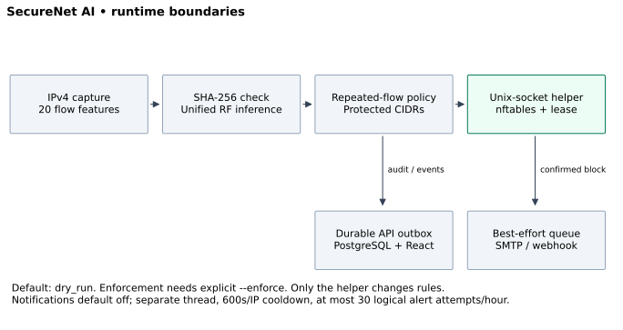
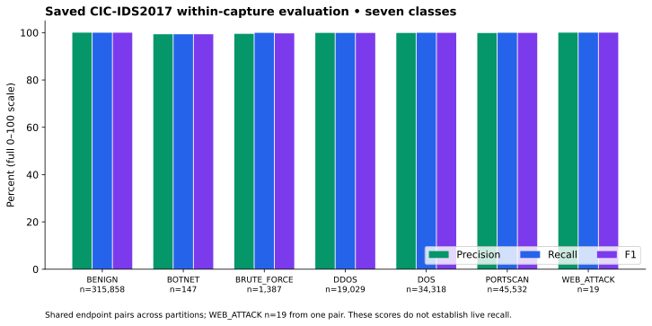
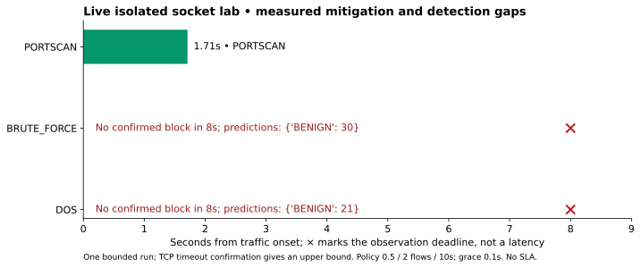

# SecureNet AI

Flow-based threat classification, authenticated monitoring and controlled response

Final Year Project • November 2026

**Evidence boundary:** isolated 3-vector enforcement passes (`model` + cross-flow `rule`); independent real-world & PCAP parity gates remain open.

---

# Problem and scope

- Give an operator useful flow-level detection and action provenance.
- Classify IPv4 flows into seven coarse families using 20 aggregate features.
- Require repeated evidence and protected-range checks before response.
- Keep payload semantics, IPv6 and gateway forwarding outside demonstrated scope.

---

# Runtime architecture

Default response is simulated. Enforcement and notifications require explicit opt-in.

---

# Data and leakage controls

- Global duplicate/conflict removal before partitioning.
- Connection groups split before training-only BENIGN caps and preprocessing.
- Random Forest selected by validation macro F1.
- Endpoint pairs still overlap across saved partitions.
- Original-capture feature parity is externally gated.

Source: `reports/unified/`, `docs/ML Engine/VALIDITY_REVIEW.md`.

---

# Saved-data metrics

Macro F1 **99.8192%** • Accuracy **99.9649%** • Benign FPR **0.027544%**

WEB_ATTACK has only **19** test flows from one endpoint pair. These scores do not establish live recall.

---

# Endpoint-disjoint synthetic diagnostic

- Three separate endpoint populations; the same traffic generator supplies all.
- Lab-trained RF/XGBoost score 100% with 20, 19 and 18 features.
- The serving model is unchanged.
- Held-out policy replay: four of six attack sources produce candidates; both DoS sources missed.
- Replay candidate delays do not measure live kernel drops.

---

# Controlled enforcement and recovery

- Privileged Unix-socket helper checks peer UID and owns one nftables table.
- Protected CIDRs, expiring IP set, bounded block count and lease watchdog.
- API manual unblock targets the exact block UUID; sensor acknowledges completion.
- SIGKILL restores connectivity by lease rollback; restart reconciles DB state.
- SIGTERM cleans up and exits 0.

---

# Live results (hybrid ML + cross-flow rules)

Strict acceptance passes (`status: ok`, exit 0): `PORTSCAN` via ML (`0.61s`), `BRUTE_FORCE` (`1.02s`) and `DOS` (`3.48s`) via bounded cross-flow rules. Raw ML labels stay unedited. No latency SLA.

---

# Optional notifications

- Separate thread and bounded queue; response enforcement never waits on SMTP/HTTP.
- New confirmed block only; simulations require explicit inclusion.
- At least **600s/IP** cooldown; at most **30 logical alert attempts/hour**.
- Block deduplication; failures consume quota and do not retry automatically.
- Loopback SMTP/webhook delivery verified; external delivery unverified.
- Best effort: restart loses queued notifications and resets quotas.

---

# Demonstration

1. Run `./scripts/netns_multi_attack_lab.sh` for private live enforcement evidence.
2. Read scan success, missed vectors, manual unblock and recovery results.
3. Use the separate dry-run React demo for inspection/provenance/unblock workflow.
4. Preview a clearly marked notification; show local receiver tests.

Full commands, prerequisites and expected results: `docs/FYP_DEFENSE.md`.

---

# Findings and next evaluation

- Safe response lifecycle is demonstrated in an isolated lab.
- Saved-data performance does not predict all live outcomes.
- Investigate brute-force/DoS errors with independent traffic and feature parity.
- Measure source-level false blocks and repeated latency/throughput distributions.
- Preserve explicit opt-in controls and honest evidence boundaries.
