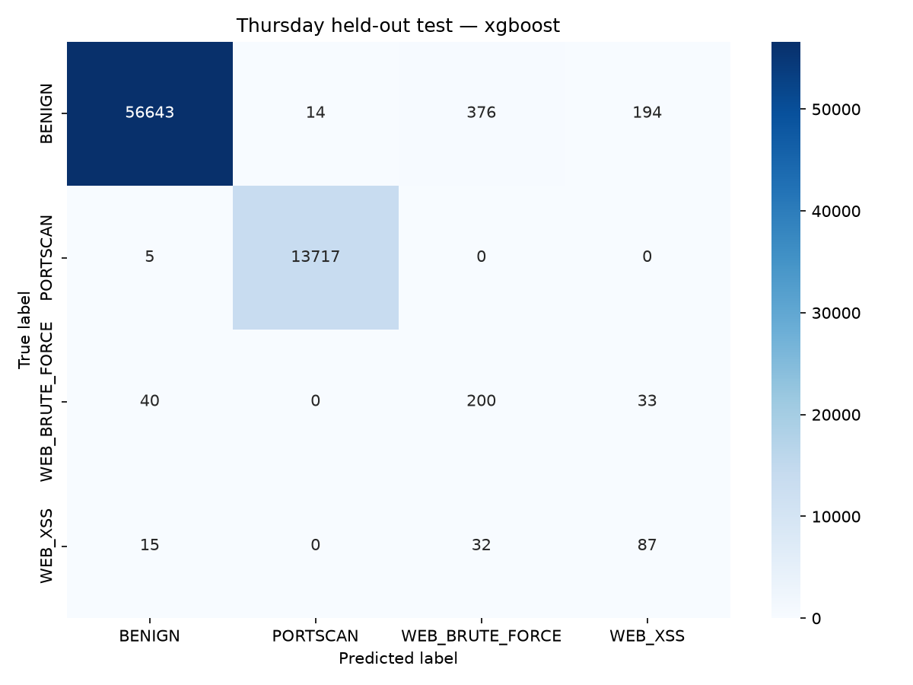

# SecureNet AI — ML engine documentation

**Validity correction:** the reported split is connection-disjoint, not campaign-
or endpoint-independent. The per-day scores do not establish live generalization.
The [validity review](VALIDITY_REVIEW.md) overrides the earlier improvement roadmap
until provenance, label semantics, campaign coverage and PCAP replay are resolved.

Documentation date: 2026-11-07, Asia/Karachi.

## 1. Scope and status

SecureNet AI classifies network flows using machine learning. The completed ML
work consists of separate corrected Friday, Thursday, Wednesday and Tuesday baselines.
All four train Random Forest and XGBoost, select a model using validation macro F1,
and evaluate the selected model on held-out original flows.

Monday's BENIGN-only data has also been cleaned and used for false-alarm evaluation
with the saved models. No Monday classifier was fitted. See
[Monday documentation](MONDAY.md) for both the full reference and the overlap-controlled
common-cohort results; these are not attack-detection metrics.

Friday achieved strong within-dataset results. Thursday achieved strong port-scan
results but weak precision/F1 for its two web families. High overall Thursday
accuracy must not be interpreted as reliable web-attack detection.

Wednesday's five-class DoS baseline is also complete, with 99.9808% held-out
accuracy and 99.8634% macro F1. See [Wednesday documentation](WEDNESDAY.md) for
its full label policy, split counts, per-class results and limitations.

Tuesday's three-class FTP/SSH baseline is complete. Random Forest won validation
selection; its held-out accuracy is 99.9984% and macro F1 is 99.9718%. See
[Tuesday documentation](TUESDAY.md) for details and independent-validation limits.

The immediate recommendation is to investigate Thursday validation errors before
replacing its dataset. No replacement dataset, new feature set, label-policy
experiment or additional tuning was performed as part of writing this document.

A packet sniffer is now present in the workspace and documented in the project
README/handoff. This document covers the saved ML runs, not an independent audit
of that later sniffer work. The sniffer CLI's current `--predict` uses Friday;
the Python prediction API can explicitly select Thursday, Wednesday or Tuesday. No dataset score
establishes live detection or automatic-blocking readiness.

## 2. Source code responsibilities

| File | Responsibility |
| --- | --- |
| [datasets.py](../../ml_engine/datasets.py) | Dataset label mappings, exclusions and artifact locations |
| [preprocess.py](../../ml_engine/preprocess.py) | Cleaning, deduplication, connection grouping and raw-valued splits |
| [train.py](../../ml_engine/train.py) | Training-only transforms/class weights, model fitting and validation selection |
| [evaluate.py](../../ml_engine/evaluate.py) | Selected model's held-out test metrics and confusion matrix |
| [predictor.py](../../ml_engine/predictor.py) | Matching bundle loading, input validation and single/batch inference |
| [conftest.py](../../tests/conftest.py) | Shared expected policies, synthetic flows, isolated paths/caches and small real estimators |
| [test_preprocessing.py](../../tests/test_preprocessing.py) | Parametrized policy/cleaning, raw values and connection split contracts |
| [test_training.py](../../tests/test_training.py) | Training-only transforms, selected bundle and saved-run guards |
| [test_inference.py](../../tests/test_inference.py) | Input validation, feature order and single/batch/direct agreement |
| [test_evaluation.py](../../tests/test_evaluation.py) | Complete reports and artifact identity/checksum checks |
| [monday.py](../../ml_engine/monday.py) | BENIGN-only reference preparation and saved-model false-alarm evaluation |
| [test_reference.py](../../tests/test_reference.py) | Normal-reference no-fitting, overlap union and fingerprint contracts |
| [test_sniffer.py](../../tests/test_sniffer.py) | Synthetic TCP/UDP flow regressions; capture parity remains unvalidated |

Friday remains the default when no dataset argument is supplied. Other days are
selected explicitly, e.g. `--dataset wednesday` or `dataset="wednesday"` in Python.
These are separate classifiers, not one model covering all weekday attack types.

## 3. Data sources and feature contract

The completed runs used `dataset/raw/friday.csv`, `dataset/raw/thursday.csv`,
`dataset/raw/wednesday.csv` and `dataset/raw/tuesday.csv`.
The separate Monday reference uses `dataset/raw/monday.csv`; its normal-only role
does not add a supervised dataset choice.
The `_plus.csv` variants were not used. Do not combine those variants with the
base files until their provenance, extra columns and overlap are established.

The original project description names CICIDS2017; an older planning file names
UNSW Canberra. Exact download/processing provenance still needs a reproducible
record. The actual local files, column names, label counts and SHA-256 checksums
are recorded in each run's `data_audit.json`.

Both models use this ordered list of 20 raw flow features:

```text
Src Port
Dst Port
Protocol
Flow Duration
Total Fwd Packet
Total Bwd packets
Flow Bytes/s
Flow Packets/s
Flow IAT Mean
Fwd Packets/s
Bwd Packets/s
Packet Length Min
Packet Length Max
Packet Length Mean
FIN Flag Count
SYN Flag Count
RST Flag Count
PSH Flag Count
ACK Flag Count
Average Packet Size
```

IP identities, timestamps, original labels, attempted status, original row IDs and
group IDs are not model features. IP/port endpoints and protocol are used to
construct connection groups for splitting. Ports remain classifier features and
may encode patterns specific to this dataset.

Live extraction must match the training feature definitions, units, direction and
flow-expiry behavior. Merely producing the same column names is insufficient.

## 4. Label policies

### Friday

| Normalized class | Source labels |
| --- | --- |
| BENIGN | BENIGN |
| BOTNET | Botnet; Botnet - Attempted |
| DDOS | DDoS |
| PORTSCAN | Portscan |

### Thursday

| Normalized class | Source labels |
| --- | --- |
| BENIGN | BENIGN |
| PORTSCAN | Infiltration - Portscan |
| WEB_BRUTE_FORCE | Web Attack - Brute Force; its Attempted variant |
| WEB_XSS | Web Attack - XSS; its Attempted variant |

Thursday explicitly excludes these scarce classes from this baseline:

| Source label | Excluded rows |
| --- | ---: |
| Infiltration | 36 |
| Infiltration - Attempted | 45 |
| Web Attack - SQL Injection | 13 |
| Web Attack - SQL Injection - Attempted | 5 |
| **Total** | **99** |

Excluded attacks are not relabelled BENIGN. Unknown labels cause an error rather
than disappearing silently. Attempted and base web labels are merged for family
detection; that classification does not establish successful compromise. Thursday
retains original labels and attempted status as metadata and reports test results
by original label as well as normalized family.

### Wednesday

| Normalized class | Source labels |
| --- | --- |
| BENIGN | BENIGN |
| DOS_GOLDENEYE | DoS GoldenEye; its Attempted variant |
| DOS_HULK | DoS Hulk; its Attempted variant |
| DOS_SLOWHTTPTEST | DoS Slowhttptest; its Attempted variant |
| DOS_SLOWLORIS | DoS Slowloris; its Attempted variant |

Wednesday explicitly excludes Heartbleed: 11 source rows in one connection group.
It cannot support independent grouped partitions. Original labels and attempted
status remain metadata. These four DOS families are distinct from Friday's DDOS
target; the day-specific models have not been combined.

### Tuesday

| Normalized class | Source labels |
| --- | --- |
| BENIGN | BENIGN |
| FTP_BRUTE_FORCE | FTP-Patator; FTP-Patator - Attempted |
| SSH_BRUTE_FORCE | SSH-Patator; SSH-Patator - Attempted |

All Tuesday source families are retained; there are no deliberate label exclusions.
Original labels/attempted status are metadata only, with subgroup test reporting.
The targets describe traffic families rather than successful authentication or
compromise. Attempted-label test support is small (three FTP and six SSH examples).

## 5. Leakage correction and preparation

The original Friday pipeline fitted StandardScaler and applied SMOTE before the
train/test split. This exposed held-out statistics and allowed related original
and synthetic examples to cross the split. Its near-perfect saved scores were
not a trustworthy generalization estimate.

The corrected pipeline performs these steps:

1. Verify required columns, normalize labels and apply explicit exclusions.
2. Convert feature/group metadata columns to numeric; remove missing, nonfinite
   or negative values and duplicate header rows.
3. Remove identical feature vectors with the same normalized label. Remove all
   remaining conflicting-label examples with identical feature vectors.
4. Form canonical bidirectional connection groups from IP/port endpoints and
   protocol. Reverse-direction and repeated connections share one group.
5. Use deterministic stratified group folds for approximately 60% training,
   20% validation and 20% test data, with random state 42.
6. Fit StandardScaler and LabelEncoder on original training rows only. Transform
   validation/test using those fitted objects.
7. Use balanced training class weights. No SMOTE, synthetic rows or undersampling
   are used in the corrected baselines.

Exact duplicate model inputs are removed across the dataset before splitting,
even when endpoint metadata differs. Checks verified no shared original rows,
connections or model inputs between partitions. These safeguards do not make the
partitions independent by host or attack campaign.

### Cleaning and partition sizes

| Item | Friday | Thursday | Wednesday | Tuesday |
| --- | ---: | ---: | ---: | ---: |
| Raw rows | 547,557 | 362,075 | 496,640 | 322,078 |
| Explicitly excluded label rows | 0 | 99 | 11 | 0 |
| Same-label duplicate rows removed | 2,086 | 5,191 | 2,101 | 2,158 |
| Conflicting-label rows removed | 0 | 4 | 0 | 0 |
| Invalid numeric rows / repeated headers found | 0 / 0 | 0 / 0 | 0 / 0 | 0 / 0 |
| Retained original flows | 545,471 | 356,781 | 494,528 | 319,920 |
| Training flows | 327,283 | 214,068 | 296,712 | 191,952 |
| Validation flows | 109,094 | 71,357 | 98,909 | 63,984 |
| Test flows | 109,094 | 71,356 | 98,907 | 63,984 |

### Thursday retained support

| Class | All retained flows | Training | Validation | Test |
| --- | ---: | ---: | ---: | ---: |
| BENIGN | 286,134 | 171,680 | 57,227 | 57,227 |
| PORTSCAN | 68,609 | 41,165 | 13,722 | 13,722 |
| WEB_BRUTE_FORCE | 1,365 | 819 | 273 | 273 |
| WEB_XSS | 673 | 404 | 135 | 134 |

## 6. Training and selection

Random Forest uses 200 trees, maximum depth 25 and balanced class weights.
XGBoost uses 200 estimators, maximum depth 10, learning rate 0.1 and balanced
training sample weights. Both use random state 42 and at most four workers.
The complete parameters, environment versions and code checksums are in
`training.json` for each run.

Macro F1 gives each class equal weight in the selection score. Benign false-positive
rate and per-class precision/recall are also reported; overall accuracy alone
would hide weak minority-class results.

| Dataset | RF validation macro F1 | XGBoost validation macro F1 | Selected model |
| --- | ---: | ---: | --- |
| Friday | 99.9295% | 99.9625% | XGBoost |
| Thursday | 67.6609% | 71.1635% | XGBoost |
| Wednesday | 99.8364% | 99.8719% | XGBoost |
| Tuesday | 100.0000% | 99.9438% | Random Forest |

The selected configuration was evaluated after validation selection. Test scores
did not choose the winner. No Thursday tuning followed its held-out evaluation.

## 7. Held-out results

| Metric | Friday | Thursday | Wednesday | Tuesday |
| --- | ---: | ---: | ---: | ---: |
| Accuracy | 99.9890% | 99.0064% | 99.9808% | 99.9984% |
| Macro F1 | 99.9927% | 70.9019% | 99.8634% | 99.9718% |
| Benign false-positive rate | 0.0122% | 1.0205% | 0.0158% | 0.0000% |
| Classification errors | 12 / 109,094 | 709 / 71,356 | 19 / 98,907 | 1 / 63,984 |

These evaluate different days and label sets; they are not a controlled comparison
of attack difficulty. All four are within-dataset grouped evaluations, not evidence of
independent-day or live performance.

Friday's 12 errors were seven benign flows predicted PORTSCAN and five PORTSCAN
flows predicted BENIGN. Its test BOTNET/DDOS predictions had no errors in their
959/19,029 examples; this does not establish perfect real-world detection.

### Thursday per-class results

| Class | Precision | Recall | F1 | Test support |
| --- | ---: | ---: | ---: | ---: |
| BENIGN | 99.89% | 98.98% | 99.43% | 57,227 |
| PORTSCAN | 99.90% | 99.96% | 99.93% | 13,722 |
| WEB_BRUTE_FORCE | 32.89% | 73.26% | 45.40% | 273 |
| WEB_XSS | 27.71% | 64.93% | 38.84% | 134 |

Thursday's 99% accuracy is dominated by BENIGN and PORTSCAN. The model flagged
584 benign flows as attacks: 376 as WEB_BRUTE_FORCE, 194 as WEB_XSS and 14 as
PORTSCAN. It also confused 33 brute-force flows with XSS and 32 XSS flows with
brute force. These are measured weaknesses, not evidence that replacing the
dataset alone will fix the classifier.

Most web examples have Attempted source labels. The test partition contains
259 attempted and 14 base-label brute-force examples, plus 130 attempted and four
base-label XSS examples. All 18 base-label examples were classified correctly,
but their small sample cannot establish reliable subgroup performance.



## 8. Saved artifacts and checks

| Dataset | Split pickle | Model directory | Run evidence |
| --- | --- | --- | --- |
| Friday | `dataset/processed/friday_splits.pkl` | `ml_engine/models/friday_v2/` | `reports/friday/` |
| Thursday | `dataset/processed/thursday_splits.pkl` | `ml_engine/models/thursday_v1/` | `reports/thursday/` |
| Wednesday | `dataset/processed/wednesday_splits.pkl` | `ml_engine/models/wednesday_v1/` | `reports/wednesday/` |
| Tuesday | `dataset/processed/tuesday_splits.pkl` | `ml_engine/models/tuesday_v1/` | `reports/tuesday/` |

Each `inference_bundle.pkl` contains the selected model, scaler, encoder, ordered
schema and training metadata together. Loading validates the bundle before caching
it. Dataset-specific caches keep all four models separate.

Prediction requires all 20 features and rejects missing, nonfinite, negative or
nonnumeric inputs. Empty batches return `[]`. Complete per-feature domain checks
(such as every discrete field's valid range) remain future work.

The suite is now organized by responsibility with shared pytest fixtures and
dataset parametrization: 121 cases pass, including four sniffer regressions.
The original 23 unittest tests were migrated and their contracts retained.
Integration fixtures use small real Random Forest and XGBoost fits, temporary
project paths and isolated inference caches. See the [test guide](../../tests/README.md).

The following full-data checks are historical run verification, separate from the
synthetic regression suite:
Full-data verification matched scaler means/variances to training only and checked
40 Thursday plus 20 Friday validation flows for inference agreement/cache isolation.
Checksums verified 23 Friday artifacts/reports/processed files unchanged after
Thursday work. See each run's `verification.json` for the recorded evidence.
Wednesday verification added 50 Wednesday inference flows and 20 each from the
previous models, checking all three caches together and 44 preserved previous files.
Tuesday verification added 30 Tuesday inference flows and 20 Friday, 20 Thursday
and 25 Wednesday flows, checking all four caches and 59 preserved previous files.
Monday verification matched its reference to original rows, reconstructed previous
exposure, checked shared eligible row IDs and false-alarm denominators, compared
30 predictions per saved model against the public API, and preserved 74 prior files.

Training refuses to overwrite nonempty model output directories. Thursday/Wednesday/Tuesday
preprocessing also refuses to replace their default splits while their trained
model directories exist. Archive a run and its reports before retraining. Evaluation
rejects a split artifact whose checksum differs from the one used for training.
Large CSVs and model pickles are ignored by Git; they must be preserved separately.

## 9. Running and viewing existing results

Run from the project directory:

```bash
cd "/home/abdulsamad/Projects/SecureNet AI"
.venv/bin/python -m ml_engine.evaluate --dataset friday
.venv/bin/python -m ml_engine.evaluate --dataset thursday
.venv/bin/python -m ml_engine.evaluate --dataset wednesday
.venv/bin/python -m ml_engine.evaluate --dataset tuesday
xdg-open reports/thursday/confusion_matrix.png
```

Evaluation reprints metrics and rewrites that day's evaluation JSON/PNG; it does
not retrain. To inspect without rewriting anything, open the saved report README,
JSON or image directly. Reprinting evaluation is not a reason to tune on test data.

For a new archived run, the pipeline commands are:

```bash
.venv/bin/python -m ml_engine.preprocess --dataset thursday
.venv/bin/python -m ml_engine.train --dataset thursday
.venv/bin/python -m ml_engine.evaluate --dataset thursday
```

Do not run preprocessing/training just to view results. The existing Thursday run
must first be archived to satisfy the overwrite guards. Preserve split artifacts
and reports together with their corresponding models.

To run regression tests:

```bash
.venv/bin/python -m pip install -r requirements-dev.txt
.venv/bin/python -m pytest -q
```

Example programmatic inference using an actual raw row:

```python
import pandas as pd
from ml_engine import predict
from ml_engine.preprocess import SELECTED_COLUMNS

row = pd.read_csv("dataset/raw/thursday.csv", usecols=SELECTED_COLUMNS, nrows=1)
result = predict(row.iloc[0].to_dict(), dataset="thursday")
print(result)
```

Run this Python example with the project's `.venv` interpreter. It demonstrates
API usage, not a meaningful benchmark from one row. Current versions are recorded
in training reports; dependency pinning is still pending.

## 10. Revised next work: validate targets, splits and extraction first

The [validity review](VALIDITY_REVIEW.md) replaces the earlier Thursday tuning plan.
Do not start another tuning cycle on the current partitions.

1. Establish the exact data release, source checksums, label definitions and
   Attempted policy. Define supported detector targets, suspending unsupported web
   subtype claims. Merging web subtypes cannot resolve invalid target semantics.
2. Identify independent campaigns/hosts and document class coverage. Many attack
   families have a single observed endpoint pair; a meaningful independent split
   may require new lab campaigns rather than another split seed.
3. Obtain matching captures and exporter version, including documented capture
   repairs. Differentially replay them through the reference exporter and sniffer,
   matching flows and measuring feature deviations and unmatched records.
4. Run paired port ablations on frozen, defensible partitions; decide coarse web
   scope using independent evidence. No port ablation has yet been run.
5. Build a unified serving candidate with joint cross-day duplicate/campaign
   handling and fresh independent evaluation. Do not concatenate existing splits
   or infer an unseen flow's capture weekday. Existing Monday results and test
   scores have been observed and cannot become untouched final holdouts.

In parallel, isolate invalid-flow errors, vectorize decoding, establish trusted
artifact loading and quarantine legacy models without losing historical evidence.
These are proposed tasks, not completed fixes. No source-capture replay has been
performed; matching PCAPs are absent locally.

Monday reference preparation and false-alarm evaluation are complete; incorporating
that data into training is still future work. The Monday report has already been
observed and must not be called an untouched holdout for a later model trained on it.

## 11. Evidence and maintenance

- [Friday report and evidence](../../reports/friday/README.md)
- [Thursday report and evidence](../../reports/thursday/README.md)
- [Wednesday methodology and results](WEDNESDAY.md)
- [Wednesday report and evidence](../../reports/wednesday/README.md)
- [Tuesday methodology and results](TUESDAY.md)
- [Tuesday report and evidence](../../reports/tuesday/README.md)
- [Monday normal-reference methodology](MONDAY.md)
- [Monday false-alarm results](../../reports/monday/README.md)
- [Thursday data audit](../../reports/thursday/data_audit.json)
- [Thursday training metadata](../../reports/thursday/training.json)
- [Thursday held-out evaluation](../../reports/thursday/evaluation.json)
- [Thursday verification](../../reports/thursday/verification.json)
- [Project handoff](../../AGENTS.md)

For subsequent experiments, document the question, source hashes, label policy,
split boundaries, feature contract, configuration, validation results and remaining
limitations. Distinguish completed work from hypotheses and proposed next steps.
