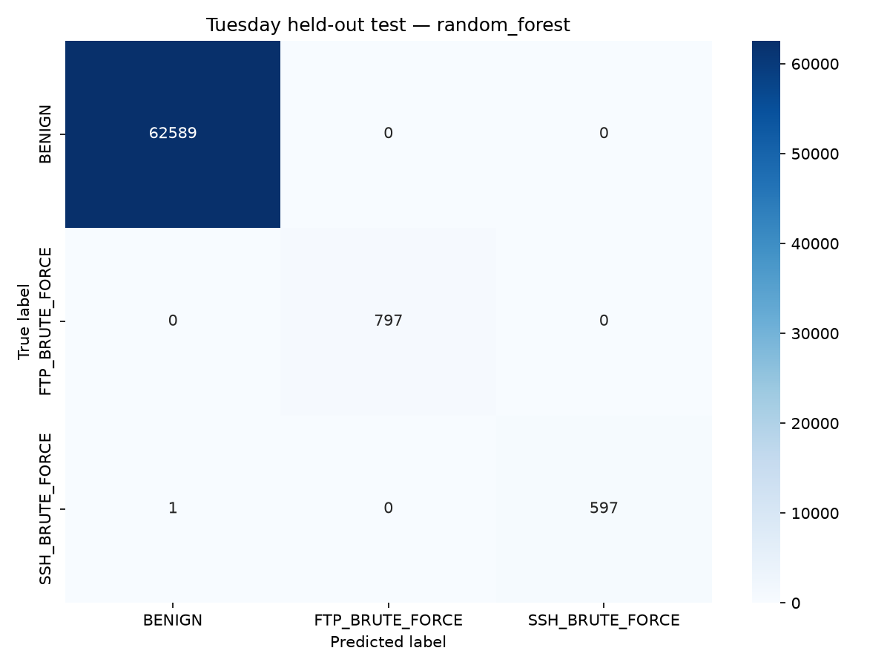

# SecureNet AI — Tuesday ML baseline

Completed: 2026-11-07 (Asia/Karachi).

**Validity correction:** each attack family has one endpoint pair shared across
all three partitions. These are exploratory within-capture scores. Read the
[validity review](VALIDITY_REVIEW.md) before interpreting them as generalization.

## Scope and label policy

The user selected Tuesday after the Friday, Thursday and Wednesday baselines.
Only `dataset/raw/tuesday.csv` was used; `tuesday_plus.csv` was not combined with
it. The existing 20 features, split strategy and model configurations were reused.
The shared implementation already supports Tuesday's three classes, so the only
ML implementation extension was adding its policy/paths to `datasets.py`.

| Source label | Raw rows | Normalized class |
| --- | ---: | --- |
| BENIGN | 315,106 | BENIGN |
| FTP-Patator | 3,972 | FTP_BRUTE_FORCE |
| FTP-Patator - Attempted | 12 | FTP_BRUTE_FORCE |
| SSH-Patator | 2,961 | SSH_BRUTE_FORCE |
| SSH-Patator - Attempted | 27 | SSH_BRUTE_FORCE |
| **Total** | **322,078** | |

Both attack families have thousands of connection groups. All source families are
included; there is no rare-label exclusion for this day. Unknown labels cause an
error. Attempted variants are merged with their family, with original labels and
attempted status retained only as metadata. These are traffic-family targets, not
proof of a successful login or compromised host.

## Cleaning and held-out isolation

Removed 2,158 duplicate BENIGN feature vectors from the raw data. No invalid
numeric rows, conflicting-label rows or repeated headers were found. The original
CSV was preserved; processed files contain 319,920 original flows.

| Class | Retained | Training | Validation | Test |
| --- | ---: | ---: | ---: | ---: |
| BENIGN | 312,948 | 187,770 | 62,589 | 62,589 |
| FTP_BRUTE_FORCE | 3,984 | 2,390 | 797 | 797 |
| SSH_BRUTE_FORCE | 2,988 | 1,792 | 598 | 598 |
| **Total** | **319,920** | **191,952** | **63,984** | **63,984** |

Connections use canonical bidirectional IP/port endpoints plus protocol. There
are 211,633 connection groups, split into 126,980 training, 42,327 validation and
42,326 test groups. Stratified group folds use random state 42. All three classes
are present in every partition.

Verified zero shared original rows, connection groups or identical model inputs
between partitions. Every split feature row matches its raw source row. IPs,
original labels, attempted status and row/group IDs are metadata, never model
features. No synthetic examples were generated.

StandardScaler and LabelEncoder were fitted only on the 191,952 original training
rows. Saved scaler means/variances match training statistics. Class weights are
computed from training only; there is no SMOTE or undersampling. See the
[shared ML documentation](ML_ENGINE.md) for the unchanged 20-feature contract.

## Training, selection and results

Random Forest uses 200 trees, maximum depth 25 and balanced class weights.
XGBoost uses 200 estimators, depth 10, learning rate 0.1 and balanced training
sample weights. Both use random state 42 and at most four workers. Full parameters,
environment versions and code/split checksums are saved in `training.json`.

| Model | Validation macro F1 | Validation benign false-positive rate |
| --- | ---: | ---: |
| Random Forest | 100.0000% | 0.0000% |
| XGBoost | 99.9438% | 0.0032% |

Selected Random Forest using validation macro F1. The predictor loads that selected
model with its matching scaler/encoder; it does not assume every day's winner is
XGBoost. Evaluated the selected configuration on test once, with no subsequent
tuning against its scores.

| Held-out test metric | Result |
| --- | ---: |
| Accuracy | 99.9984% |
| Macro F1 | 99.9718% |
| Benign false-positive rate | 0.0000% (0 / 62,589) |
| Errors | 1 / 63,984 |

| Class | Precision | Recall | F1 | Test support |
| --- | ---: | ---: | ---: | ---: |
| BENIGN | 99.9984% | 100.0000% | 99.9992% | 62,589 |
| FTP_BRUTE_FORCE | 100.0000% | 100.0000% | 100.0000% | 797 |
| SSH_BRUTE_FORCE | 100.0000% | 99.8328% | 99.9163% | 598 |

The only error was one base-label SSH-Patator flow classified BENIGN. No benign
flow was flagged and no FTP/SSH cross-family error occurred in this test partition.
The attempted-label test subgroups have only three FTP and six SSH examples;
although all were classified correctly, their support is too small for a reliable
separate attempted-attack performance claim.



Unrounded metrics, original-label counts and subgroup predictions are in
[evaluation.json](../../reports/tuesday/evaluation.json).

## Artifacts, checks and commands

- `dataset/processed/cleaned_tuesday.csv`: cleaned, raw-valued features/labels.
- `dataset/processed/tuesday_splits.pkl`: partitions and audit metadata.
- `ml_engine/models/tuesday_v1/`: both models, transforms, metadata and selected
  Random Forest `inference_bundle.pkl`.
- `reports/tuesday/`: audit, training/evaluation results, verification, preservation
  hashes and confusion-matrix image.

Tuesday is now a parametrized case in the [shared pytest suite](../../tests/README.md): source-label and
attempted-metadata mapping, merged duplicates/conflicts and connection isolation,
and an executable three-class pipeline with inference, dataset identity and
overwrite checks. The original run had 20 passing project tests; those contracts
are retained in the consolidated suite.

Verified 30 Tuesday validation predictions plus 20 Friday, 20 Thursday and 25
Wednesday predictions in one process, without cache mixing. Single/batch/direct
bundle predictions agree. Missing features are rejected and empty batches return
`[]`. SHA-256 checks verified 59 previous model/report/processed/sniffer files
unchanged. No sniffer, firewall, backend or other-day training changes were made.

To view existing results from the project folder:

```bash
.venv/bin/python -m ml_engine.evaluate --dataset tuesday
xdg-open reports/tuesday/confusion_matrix.png
```

Evaluation reprints metrics and rewrites Tuesday's evaluation JSON/image. For
read-only inspection, open the saved JSON/image directly. No training is needed
to see results. For a fresh run after archiving the previous models/splits/reports:

```bash
.venv/bin/python -m ml_engine.preprocess --dataset tuesday
.venv/bin/python -m ml_engine.train --dataset tuesday
.venv/bin/python -m ml_engine.evaluate --dataset tuesday
```

Inference uses `predict(features, dataset="tuesday")` with all 20 raw values.
Friday remains the default, including the sniffer CLI's current `--predict`.
Default Tuesday preprocessing/training refuse to replace an existing trained run.

## Interpretation and remaining work

These are within-Tuesday grouped results on one local dataset variant. Hosts and
attack campaigns can recur across partitions, and service ports can encode
dataset-specific patterns. Timestamps lack full date/hour information, so no
chronological split was used. Exact provenance and independent host/day/lab/live
validation remain open. Zero observed false positives here is not a guarantee of
zero false positives on legitimate FTP/SSH traffic elsewhere.

The four attack-day baselines remain separate. They have not been combined into
one deployed classifier covering all families. A future combined model needs
joint deduplication/grouping across original day files before splitting. Do not
route unknown live flows to a day model by assuming the attack family in advance.
Monday normal traffic, Thursday web-class improvement, a unified classifier and
live validation require separate scope. Keep the observed test partition out of
further tuning, and use fresh independent data for later generalization claims.

See the [Tuesday run evidence](../../reports/tuesday/README.md),
[data audit](../../reports/tuesday/data_audit.json) and
[verification](../../reports/tuesday/verification.json).
