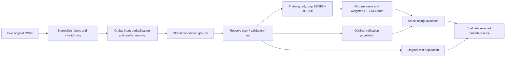

# Unified detector — experimental baseline

Updated: 2026-11-08 (Asia/Karachi).

The unified candidate combines the five original weekday CSVs. It provides one
label space and one inference bundle. It does not establish independent-campaign
or live detection performance; the [validity review](VALIDITY_REVIEW.md) still applies.

## Agreed targets and features

The user selected seven operational classes and the existing 20 features. Raw
source IPs and connection/provenance fields remain metadata, not classifier inputs.

| Unified target | Supported source labels |
| --- | --- |
| BENIGN | BENIGN and supported Attempted variants |
| BOTNET | Botnet |
| BRUTE_FORCE | FTP-Patator, SSH-Patator |
| DDOS | DDoS |
| DOS | DoS GoldenEye, DoS Hulk, DoS Slowhttptest, DoS Slowloris |
| PORTSCAN | Portscan, Infiltration - Portscan |
| WEB_ATTACK | Web Attack - Brute Force, Web Attack - XSS |

The excluded families remain Heartbleed, Infiltration (including Attempted), and
Web Attack - SQL Injection (including Attempted). Exclusions take precedence over
the Attempted policy. The original labels are retained for subgroup reporting.
Legacy weekday policies are preserved; their targets differ from this experiment.

## Preparation and split contract



`ml_engine.unify` reads selected columns in chunks, one CSV at a time. It records
source checksums, source-local row IDs, original labels, invalid/header/excluded
row counts and the exact target mapping. It uses only the five base files, with
no `_plus` variants or previously prepared splits.

Normalization happens per chunk; duplicate/conflicting input removal happens
globally. Removing conflicts independently in each chunk could hide contradictory
targets in a later chunk. All copies of a globally conflicting model input are
excluded. Same-target identical inputs are represented once.

Canonical bidirectional IP/port/protocol keys are recomputed across all sources.
Source-local group IDs are never concatenated. These keys omit dates and may
conservatively merge reused endpoint tuples from different days. They are not
campaign identifiers. Endpoint-pair overlap is explicitly reported by class.

Global connection-grouped partitions are reserved approximately 60/20/20 first.
Then only training BENIGN rows are capped at 150,000. Sampling aims for 30,000 per
source day; sources with insufficient remaining rows contribute what is available,
and unused quotas are filled from other training sources. Original attack training
rows are retained. Discarded training row IDs are saved for accounting.

Validation/test distributions are never balanced or capped. Their counts need not
match the attachment's estimates, which applied sampling before partitioning.
The cleaned CSV represents the complete globally cleaned population; the split
pickle includes the actual capped training partition and unchanged held-out ones.

## Training and serving

RF and XGBoost each use 200 trees, fixed seeds and at most two worker threads for
this scope. StandardScaler, LabelEncoder and balanced class weights use the final
training rows only. Validation macro F1 selects the model; test results do not
select or tune it. No synthetic samples are generated.

```bash
.venv/bin/python -m ml_engine.unify
.venv/bin/python -m ml_engine.train --dataset unified
.venv/bin/python -m ml_engine.evaluate --dataset unified
```

Preparation refuses an existing unified split/cleaned file, nonempty report
directory or trained run. Training refuses nonempty model outputs. Archive a run
and its reports before rebuilding. To inspect saved results, read the reports;
preparing/training again is unnecessary.

`predict(flow)` and `predict_batch(flows)` now select `unified` by default. They
require all 20 raw-valued features and reject invalid inputs. Missing unified
artifacts fail clearly without falling back to Friday.

```python
from ml_engine import predict

# flow must contain all 20 actual feature values.
result = predict(flow)
legacy_result = predict(flow, dataset="friday")
```

```bash
.venv/bin/python -m sniffer.main -r capture.pcap --predict
.venv/bin/python -m sniffer.main -r capture.pcap --predict --dataset friday
```

The sniffer remains detection-only. It skips `FeatureValidationError` inputs while
allowing model/artifact failures to surface. A single serving model provides the
seven configured labels; its availability is not a guarantee that it correctly
detects each attack in real traffic.

## Outputs and verification

| Path | Contents |
| --- | --- |
| `dataset/processed/cleaned_unified.csv` | Globally cleaned original inputs with target/source metadata |
| `dataset/processed/unified_splits.pkl` | Raw-valued partitions, audit and discarded training row IDs |
| `ml_engine/models/unified_v1/inference_bundle.pkl` | Selected classifier with matching scaler, encoder and metadata |
| `reports/unified/data_audit.json` | Source hashes, counts, policies, split and endpoint-overlap diagnostics |
| `reports/unified/training.json` | Both validation results, selected model and training environment |
| `reports/unified/evaluation.json` | Seven-class test metrics, original-label breakdown and per-source false alarms |
| `reports/unified/confusion_matrix.png` | Selected model's test confusion matrix |

The shared pytest cases now include the seven-class configuration.
`tests/test_unification.py` checks cross-day/chunk conflicts, connection grouping,
source-row feature parity, training-only sampling, deterministic splits, real
small-model training/inference/evaluation and default-model behavior.

The completed run retained 2,081,457 of 2,099,971 source rows. Final training,
validation and test contain 451,304, 416,291 and 416,290 flows respectively.
Random Forest won validation selection. Test accuracy is 99.9649283%, macro F1
99.8192265%, and benign false-positive rate 0.0275440% (87/315,858).

All 169 parametrized tests pass. Full source-row, split, scaler and inference
checks passed; SHA-256 confirms 89 previous files unchanged. The offline synthetic
PCAP smoke test checks default CLI wiring, not original-capture feature parity.
Preparation took 665.33 seconds and training 142.12 seconds on this machine.
See the [completed run report](../../reports/unified/README.md) for exact counts,
per-class/per-source results, verification and measured resources.

WEB_ATTACK has only 19 test examples from one endpoint pair shared across splits.
Its 19 correct predictions do not establish robust web-exploit detection. A
test-suite pass establishes software regression coverage only.

## Unresolved limits

- Exact source release/exporter provenance and original-PCAP parity remain open.
- Hosts/campaigns occur in multiple partitions. No independent lab holdout exists.
- These sources and prior test populations have already been examined during
  earlier experiments; this is not a fresh external evaluation.
- Source-port shortcuts remain possible. No port ablation was included in this run.
- Non-Attempted web attacks have limited support. Coarse WEB_ATTACK does not add
  HTTP payload semantics or guarantee web-exploit detection.
- Returned confidence scores have not been calibrated for live class prevalence;
  training subsampling and class weights change the learning population.
- Pickle artifacts require trusted files and a compatible environment. They and
  large datasets are ignored by Git; local commits do not back them up.
