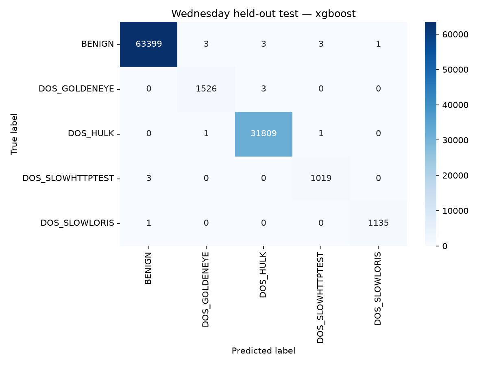

# SecureNet AI — Wednesday ML baseline

Completed: 2026-11-07 (Asia/Karachi).

**Validity correction:** each DoS family has one endpoint pair shared across all
three partitions. These are exploratory within-capture scores. Read the
[validity review](VALIDITY_REVIEW.md) before interpreting them as generalization.

## Purpose and scope

The user selected Wednesday as the next dataset after Friday and Thursday. The
run reused the corrected 20-feature pipeline with its grouped splits,
training-only transformations and class weighting. Only `wednesday.csv` was used;
`wednesday_plus.csv` was not combined with it.

The new model distinguishes normal traffic and four DoS families. It is separate
from Friday's BENIGN/BOTNET/DDOS/PORTSCAN model and Thursday's web/port-scan model.
No combined model, sniffer behavior, backend or firewall functionality was changed.

## Source labels and target policy

| Source family | Base-label rows | Attempted rows | Normalized class |
| --- | ---: | ---: | --- |
| Normal | 319,119 | — | BENIGN |
| DoS GoldenEye | 7,567 | 80 | DOS_GOLDENEYE |
| DoS Hulk | 158,468 | 581 | DOS_HULK |
| DoS Slowhttptest | 1,740 | 3,368 | DOS_SLOWHTTPTEST |
| DoS Slowloris | 3,859 | 1,847 | DOS_SLOWLORIS |
| Heartbleed | 11 | — | Excluded |

The source contains 496,640 rows. Heartbleed's 11 rows form only one bidirectional
connection group; placing examples from that same group into different partitions
would defeat the isolation policy. Heartbleed was excluded explicitly, not
relabelled BENIGN or synthetically expanded into the test set.

Base/Attempted variants are merged to learn a traffic family. Original labels and
attempted status remain metadata and appear in subgroup evaluation. The targets
do not establish successful compromise. Unexpected labels cause an error.

## Cleaning and split integrity

Removed 2,101 identical same-label feature vectors. No invalid numeric rows,
conflicting-label examples or repeated headers were found. Retained 494,528 flows.
Raw source files were preserved; cleaning writes separate processed artifacts.

| Class | Retained | Training | Validation | Test |
| --- | ---: | ---: | ---: | ---: |
| BENIGN | 317,045 | 190,227 | 63,409 | 63,409 |
| DOS_GOLDENEYE | 7,647 | 4,589 | 1,529 | 1,529 |
| DOS_HULK | 159,049 | 95,423 | 31,815 | 31,811 |
| DOS_SLOWHTTPTEST | 5,108 | 3,065 | 1,021 | 1,022 |
| DOS_SLOWLORIS | 5,679 | 3,408 | 1,135 | 1,136 |
| **Total** | **494,528** | **296,712** | **98,909** | **98,907** |

Connection identity uses canonical bidirectional IP/port endpoints plus protocol.
The complete dataset contains 226,691 such groups. Training/validation/test contain
136,014/45,338/45,339 groups respectively. All five classes are present in every
partition. Random state is 42 and partitions are approximately 60/20/20.

Actual checks found zero overlapping original rows, connection groups or identical
feature vectors across partitions. Every saved feature row matches its source CSV
row; no synthetic rows were introduced. IPs, row/group IDs, original labels and
attempted status are metadata only. The existing 20-feature schema is unchanged.

See [the shared ML documentation](ML_ENGINE.md) for the feature list and grouping
method. This is not a chronological split; timestamps lack full date/hour fields.

## Training and selection

StandardScaler and LabelEncoder were fitted on 296,712 original training rows.
Their fitted statistics were not influenced by validation/test. Verified scaler
means and variances match training only.

Used the same model configurations as the earlier baselines: Random Forest with
200 trees/depth 25 and XGBoost with 200 estimators/depth 10/learning rate 0.1.
Both use balanced training class weights, random state 42 and at most four workers.
There is no SMOTE, undersampling or synthetic training data in this run.

| Model | Validation macro F1 | Validation benign false-positive rate |
| --- | ---: | ---: |
| Random Forest | 99.8364% | 0.0063% |
| XGBoost | 99.8719% | 0.0095% |

XGBoost won on the predefined validation macro F1 criterion. Random Forest's lower
validation false-positive rate is recorded as a tradeoff; test metrics were not
used to change the criterion or choose the winner.

## Held-out performance

Evaluated the selected XGBoost once on the 98,907 original test flows, then froze
the baseline without tuning against these results.

| Metric | Result |
| --- | ---: |
| Accuracy | 99.9808% |
| Macro F1 | 99.8634% |
| Benign false-positive rate | 0.0158% (10 / 63,409) |
| Classification errors | 19 / 98,907 |

| Class | Precision | Recall | F1 |
| --- | ---: | ---: | ---: |
| BENIGN | 99.99% | 99.98% | 99.99% |
| DOS_GOLDENEYE | 99.74% | 99.80% | 99.77% |
| DOS_HULK | 99.98% | 99.99% | 99.99% |
| DOS_SLOWHTTPTEST | 99.61% | 99.71% | 99.66% |
| DOS_SLOWLORIS | 99.91% | 99.91% | 99.91% |

Of the 19 errors, ten are benign flows flagged as attacks, four are attacks
labelled benign, and five are confusion between DoS families. GoldenEye's attempted
subgroup has only 17 test examples: 14 classified GoldenEye and three classified
Hulk. This small subgroup illustrates why aggregate scores need supporting counts.



The full original-label breakdown and unrounded scores are in
[evaluation.json](../../reports/wednesday/evaluation.json).

## Files, tests and reproduction

The only ML implementation extension needed was adding Wednesday's explicit
policy/paths to [datasets.py](../../ml_engine/datasets.py); the existing shared
pipeline already supports arbitrary configured class counts. Wednesday is now a
parametrized case in the [shared pytest suite](../../tests/README.md), covering all
DoS variants, the exclusion/metadata policy, merged duplicates/conflicts, grouped
isolation, five-class probabilities, wrong-day artifacts and overwrite guards.
The original run had 17 passing project tests; those contracts are retained in
the consolidated suite.

Saved artifacts:

- `dataset/processed/cleaned_wednesday.csv`: raw-valued cleaned features/labels.
- `dataset/processed/wednesday_splits.pkl`: partitions and audit metadata.
- `ml_engine/models/wednesday_v1/`: both models, scaler, encoder, metadata and
  selected `inference_bundle.pkl`.
- `reports/wednesday/`: audit, training/evaluation reports, figure, verification
  and preservation checksums.

Verified inference on 50 Wednesday validation flows and 20 each for Friday and
Thursday in one process; caches and class probabilities remain separate. Verified
44 previous model/report/processed/sniffer files unchanged by SHA-256.

To view existing results from the project directory:

```bash
.venv/bin/python -m ml_engine.evaluate --dataset wednesday
xdg-open reports/wednesday/confusion_matrix.png
```

Evaluation reprints metrics and rewrites only Wednesday's evaluation report/figure.
For read-only inspection, open the saved JSON/image directly. No preprocessing or
retraining is needed to see results. After archiving the existing run, a fresh run
uses `python -m ml_engine.preprocess --dataset wednesday` followed by the matching
training and evaluation commands, all with the project's `.venv` interpreter.

Programmatic inference: `predict(features, dataset="wednesday")`, with all 20 raw
feature values. Omitting the dataset still means Friday. The sniffer CLI's current
`--predict` still calls Friday; no live Wednesday pipeline was enabled.

## Limits and next steps

These scores describe one local dataset variant and a within-day connection-group
split. Hosts, campaigns and dataset-specific port patterns may recur across
partitions. Source provenance and independent host/day/lab validation remain open.
Heartbleed is outside coverage, and attempted-family predictions do not prove a
successful attack. No scores here justify automatic blocking on live traffic.

Keep this observed test partition out of further tuning. Future work should use
training/validation or fresh independent data. Thursday web-class weaknesses remain
unresolved by adding Wednesday. Tuesday expansion, a combined cross-day model and
live validation require separate work; a combined model must deduplicate and group
across original days before splitting.

See the [Wednesday report](../../reports/wednesday/README.md) and
[verification evidence](../../reports/wednesday/verification.json).
