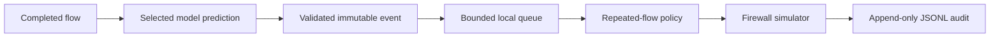

# Local response engine — first integration chunk

Updated: 2026-11-08 (Asia/Karachi).

The detection prototype now feeds a local response simulator. `--respond` logs
policy decisions and proposed firewall commands. The controller has no command
executor and cannot apply rules to the host. Real prevention is a later lab-gated
milestone. The [ML validity limits](<ML Engine/VALIDITY_REVIEW.md>) still apply.

## Run the offline demonstration

From the repository root, using the existing environment and unified bundle:

```bash
.venv/bin/python scripts/create_response_demo.py
.venv/bin/python -m sniffer.main -r runtime/response_demo.pcap --predict --respond
```

The generator writes three two-packet TCP exchanges to a PCAP. It uses explicit
Ethernet addresses and sends no network traffic. It refuses to replace an existing
PCAP; pass another output path for a new fixture.

Each completed flow still prints its features/prediction to stdout. The response
consumer appends records to `runtime/alerts.jsonl`; stderr shows the final queue and
response summary. Inspect the log with:

```bash
tail -n 3 runtime/alerts.jsonl
```

The measured smoke used `runtime/response_demo_offline.pcap` and wrote
`runtime/response_demo_alerts.jsonl`. The actual saved Random Forest labelled all
three flows PORTSCAN (score 0.9966566), giving two alerts then one `would_block`
proposal. All three accepted events were logged. This verifies wiring on synthetic
traffic; it is not evidence of original-PCAP parity or independent detection.

To replay another PCAP and protect selected administrative addresses:

```bash
.venv/bin/python -m sniffer.main -r capture.pcap --predict --respond \
  --alert-log runtime/replay-alerts.jsonl \
  --protect 10.0.0.1 --protect 10.0.0.53 --protect 10.0.0.10/32
```

`--respond` requires `--predict`. Omitting it preserves the existing detection-only
CLI. Historical `--dataset` overrides remain available, with alert-only response
policies because their target definitions differ from unified.

## Data path and responsibilities



| Component | Responsibility |
| --- | --- |
| `sniffer/events.py` | IPv4 metadata, 20 finite nonnegative features, port/protocol ranges, model-matching prediction probabilities and immutable snapshots |
| `sniffer/publisher.py` | Bounded thread-safe in-process queue and explicit overflow accounting |
| `sniffer/rules.py` | Bounded repeated-flow evidence, duplicate-ID suppression and alert-only coverage gates |
| `backend/firewall.py` | Protected CIDRs, idempotent simulated blocks, capacity and monotonic expiry |
| `backend/worker.py` | One background consumer, policy/firewall dispatch, audit writes and orderly shutdown |
| `sniffer/main.py` | Opt-in response integration and visible failure/drop reporting |

Events retain UUID, observation time, input features, source/destination endpoints,
model scope/run, label, score distribution and the SHA-256 of the exact bundle
bytes deserialized. Cached predictions retain that original hash if the disk file
changes. This hash is provenance; it does not authenticate a pickle or make an
untrusted model safe to load. Loading reads the serialized bundle into memory once
to establish that identity. Prediction return fields are unchanged.

`observed_at` is UTC processing time when the event is created, not the capture's
packet timestamp. Each audit record also contains `recorded_at`, effective policy
settings, protected CIDRs and simulated block duration.

## Default policy

| Setting | Default / behavior |
| --- | --- |
| Confidence threshold | 0.90; an experimental model score, not a calibrated correctness guarantee |
| Repeated evidence | Three distinct event IDs for the same source IP, model hash and attack class |
| Evidence window | 60 seconds of consumer processing time |
| BENIGN | `ignore`, still recorded for validation |
| WEB_ATTACK | Always alert-only because coverage is unvalidated |
| Historical models | Always alert-only for attack labels |
| Other unified attacks | `candidate` only after score and repeated-flow gates |
| Queue | 1,024 events; a full queue rejects the incoming event without blocking capture |
| Simulated block duration | 900 seconds; subsequent candidates do not extend the deadline |
| Simulated block limit | 4,096 active source IPs |

An eligible candidate can still be protected or capacity-limited by the firewall
simulator. These outcomes are recorded explicitly. The policy retains at most
4,096 source/model/class keys and 8,192 recent event IDs; bounded eviction can lose
older evidence or duplicate suppression. It is not an exactly-once transport.

Loopback, unspecified/zero-network, link-local, multicast and reserved high IPv4
ranges are protected. Add gateway, DNS, sensor and admin IPs/CIDRs with `--protect`.
There is no automatic gateway/DNS discovery or blanket private-subnet exemption;
private networks may contain the lab's attacking host.

Other settings: `--queue-size`, `--response-confidence`, `--response-min-flows`,
`--response-window`, and `--block-seconds`. Invalid values fail at startup.

## Storage and failure behavior

- `runtime/` is ignored by Git. New audit files have mode 0600. Existing files
  retain their permissions. Logs append across runs and currently have no rotation.
- Every successfully processed detection, including BENIGN/low-score/web events,
  has an audit record. Expiry produces a separate `firewall` record.
- Queue overflow produces a stderr warning and increments `dropped`. It loses that
  incoming response event; its prediction still appears on stdout.
- Invalid event metadata is rejected with a stderr warning. Invalid model inputs
  retain the existing per-flow rejection boundary. Model failures surface.
- Normal EOF/Ctrl-C closes publishing, drains accepted events and joins the worker.
  A worker/disk failure closes publishing and raises, rather than reporting success.
  The summary distinguishes accepted, processed, pending, dropped and unlogged.
- The worker checks simulated expiry on idle ticks and between events. State exists
  only in that process; restarting does not reconstruct simulated blocks from logs.
- JSONL is flushed per line but is not a transactional database or an fsync-backed
  durable queue. One local dispatcher owns its log; multi-process delivery and
  crash recovery are outside this chunk.

## Revised sprint sequence and remaining gates

| Chunk | Deliverable / status |
| --- | --- |
| 1 | Local structured events, bounded queue, audit log and dry-run firewall decisions — implemented |
| 2 | Persistent alert/action database, authenticated API, broker adapter with explicit failure/retry semantics |
| 3 | Isolated lab and differential replay; quantify false alarms, missed attacks, direction attribution, packet loss and latency |
| 4 | Validated response policy and privileged firewall service with owned chains, durable block state, restart reconciliation and rollback |
| 5 | Dashboard, authenticated administrative controls and WebSocket updates |
| 6 | Deployment packaging and repeatable end-to-end demonstration with measured acceptance criteria |

The supplied plan's claim that live detection is already validated is too strong.
Neither 90% scores nor three correlated flows establish safe prevention. A source
IP is a proposed target from extractor direction, not proof of an attacker's
identity. One-second response from attack onset is unsupported: completed flows
can wait for a five-second teardown grace or 120-second timeout. No new immediate
SYN-flood heuristic was implemented; single-packet flows remain outside this model.

The proposed `INPUT` commands describe host-local filtering only. Their placement,
earlier accept rules, forwarding/NAT, spoofed sources and capture location must be
resolved before live execution. PCAP replay currently evaluates windows by
processing time, not historical packet spacing, so replay proposals are wiring
demonstrations. Redis, HTTP/WebSockets, database integration, dashboard and actual
firewall execution are not part of the completed first chunk.

## Verification

```bash
.venv/bin/python -m pytest -q
```

The suite includes events/policy/worker contracts in `tests/test_response.py`,
firewall simulation in `tests/test_firewall.py`, sniffer CLI integration and exact
cached-model identity. Tests exercise overflow, expiry, protection, disk failures
and the final-publish/shutdown race with temporary files and controlled clocks.
Scapy interface enumeration may require access outside a restricted sandbox even
for synthetic tests. No unit test needs root capture or actual firewall commands.
See the [saved response evidence](../reports/response/README.md).
