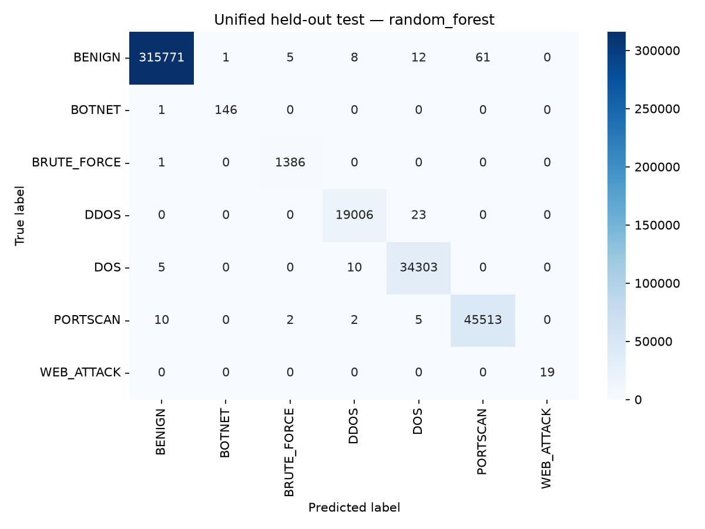

# Unified seven-class experimental baseline — 2026-11-08

**Interpretation:** connection-held-out results from already inspected lab captures.
Attack endpoint pairs remain shared across partitions. These results do not establish
independent-campaign or live detection. WEB_ATTACK has only 19 test examples.

The user selected seven broad classes, the existing 20 features, and supported
Attempted flows mapped to BENIGN. Rare excluded families retain their exclusions.
See [methodology and commands](../../docs/ML%20Engine/UNIFIED.md) and the
[validity review](../../docs/ML%20Engine/VALIDITY_REVIEW.md).

## Data preparation

- 2,099,971 original rows across five base CSVs; no plus files or prepared weekday splits used.
- Excluded 110 rare-family rows; invalid/header rows: 0/0.
- Removed 18,400 same-target duplicate inputs and 4 remaining contradictory-target rows globally.
- Retained 2,081,457 original flows in 1,083,995 global connection groups.
- Reserved approximately 60/20/20 partitions before subsampling. No fitted transforms or synthetic rows in preparation.
- Capped training BENIGN at 150,000 (30,000/source day); discarded 797,572 training-only benign rows.
- Validation and test retain their cleaned source prevalence. Discarded original training IDs are retained in the split payload.

| Class | Clean population | Training | Validation | Test |
| --- | ---: | ---: | ---: | ---: |
| BENIGN | 1,579,288 | 150,000 | 315,858 | 315,858 |
| BOTNET | 736 | 441 | 148 | 147 |
| BRUTE_FORCE | 6,933 | 4,159 | 1,387 | 1,387 |
| DDOS | 95,144 | 57,086 | 19,029 | 19,029 |
| DOS | 171,607 | 102,970 | 34,319 | 34,318 |
| PORTSCAN | 227,658 | 136,594 | 45,532 | 45,532 |
| WEB_ATTACK | 91 | 54 | 18 | 19 |

## Selection and held-out results

Both candidates used 200 trees, fixed seeds, at most two workers and training-only balanced weights.
Scaler/encoder fit on the final 451,304 original training rows only.

| Candidate | Validation macro F1 | Validation benign FPR |
| --- | ---: | ---: |
| random_forest | 99.88662135% | 0.03799176% |
| xgboost | 99.52542569% | 0.02627763% |

Selected **random_forest** using validation macro F1 before test evaluation.
No test-driven tuning or second configuration was run.

| Test metric | Value |
| --- | ---: |
| Rows | 416,290 |
| Accuracy | 99.96492830% |
| Macro F1 | 99.81922648% |
| Benign false-positive rate | 0.02754402% (87/315,858) |
| Errors | 146 |

Errors: 87 benign flows flagged, 17 attacks labelled BENIGN, and 42 attacks assigned another attack family.

| Class | Precision | Recall | F1 | Support |
| --- | ---: | ---: | ---: | ---: |
| BENIGN | 99.9946% | 99.9725% | 99.9835% | 315,858 |
| BOTNET | 99.3197% | 99.3197% | 99.3197% | 147 |
| BRUTE_FORCE | 99.4975% | 99.9279% | 99.7122% | 1,387 |
| DDOS | 99.8949% | 99.8791% | 99.8870% | 19,029 |
| DOS | 99.8835% | 99.9563% | 99.9199% | 34,318 |
| PORTSCAN | 99.8662% | 99.9583% | 99.9122% | 45,532 |
| WEB_ATTACK | 100.0000% | 100.0000% | 100.0000% | 19 |

**19/19 WEB_ATTACK predictions are correct within this partition.** The sample
contains 17 base web-brute-force rows and two base XSS rows from one endpoint pair;
it does not justify a robust web-exploit coverage claim. Changing the Attempted
policy and targets makes direct comparisons with the earlier Thursday scores invalid.



## Per-source false positives in the unified test partition

| Source | Benign rows | False positives | Rate |
| --- | ---: | ---: | ---: |
| friday | 57,799 | 21 | 0.036333% |
| monday | 74,374 | 5 | 0.006723% |
| thursday | 57,213 | 39 | 0.068166% |
| tuesday | 62,417 | 14 | 0.022430% |
| wednesday | 64,055 | 8 | 0.012489% |

These denominators differ from the earlier Monday common cohort. Monday is now
a source for this model; its test subset is not independent-host/campaign evidence.

## Verification and preservation

- 169 parametrized pytest cases pass; dependency deprecation warnings remain visible.
- Full source-row checks matched every retained split feature, original/mapped label, global row ID and canonical connection hash to its CSV.
- Cross-partition source IDs, connection groups and identical numeric model inputs are disjoint.
- Scaler mean/variance and fitted-row count match training-only statistics.
- Default batch/single/direct and feature-order checks agree on 21 training examples covering all seven classes.
- Explicit inference still works for all four historical weekday models.
- SHA-256 confirms 89 prior source/artifact/report files unchanged.
- The default CLI produced one valid seven-class prediction from a synthetic PCAP, matching the public API. This is not original-capture parity.

## Measured resources

| Stage | Wall seconds | Peak process RSS (GiB) |
| --- | ---: | ---: |
| preprocess | 665.33 | 2.398 |
| train | 142.12 | 0.830 |
| evaluate | 9.95 | 0.700 |
| verification | 39.70 | 1.767 |

Preprocessing took about 11 minutes, dominated by the global stratified group split.
Training took about 2.4 minutes on this machine. These are measured observations,
not general runtime/RAM guarantees; host swap was already in use.

## Artifacts and commands

- `data_audit.json`: source hashes, exact target/exclusion policy, natural held-out counts and endpoint overlap.
- `training.json`: both validation results, winner, parameters, dependencies and split checksum.
- `evaluation.json`: selected model test metrics, original-label target breakdown and per-source false alarms.
- `verification.json`: source/statistics/inference checks, synthetic-PCAP smoke and artifact/code hashes.
- `preserved_previous_runs.json`: SHA-256 baseline for the 89 previous files.
- `resources.json`: measured process resources and test-suite result.
- Bundle: `ml_engine/models/unified_v1/inference_bundle.pkl` (generated and ignored by Git).

```bash
.venv/bin/python -m pytest -q
.venv/bin/python -m sniffer.main -r capture.pcap --predict
```

Read these saved files to inspect results. Archive models, splits and reports before
future preprocessing/training. Independent campaigns, exact release provenance,
PCAP feature parity, port ablation and live calibration remain open. No backend,
firewall action, actual network capture or production-readiness validation was added.
